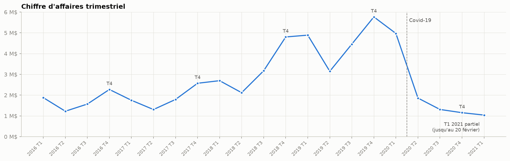
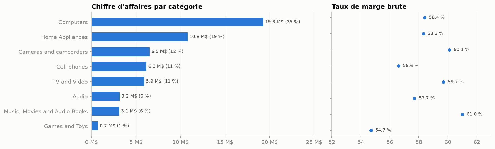
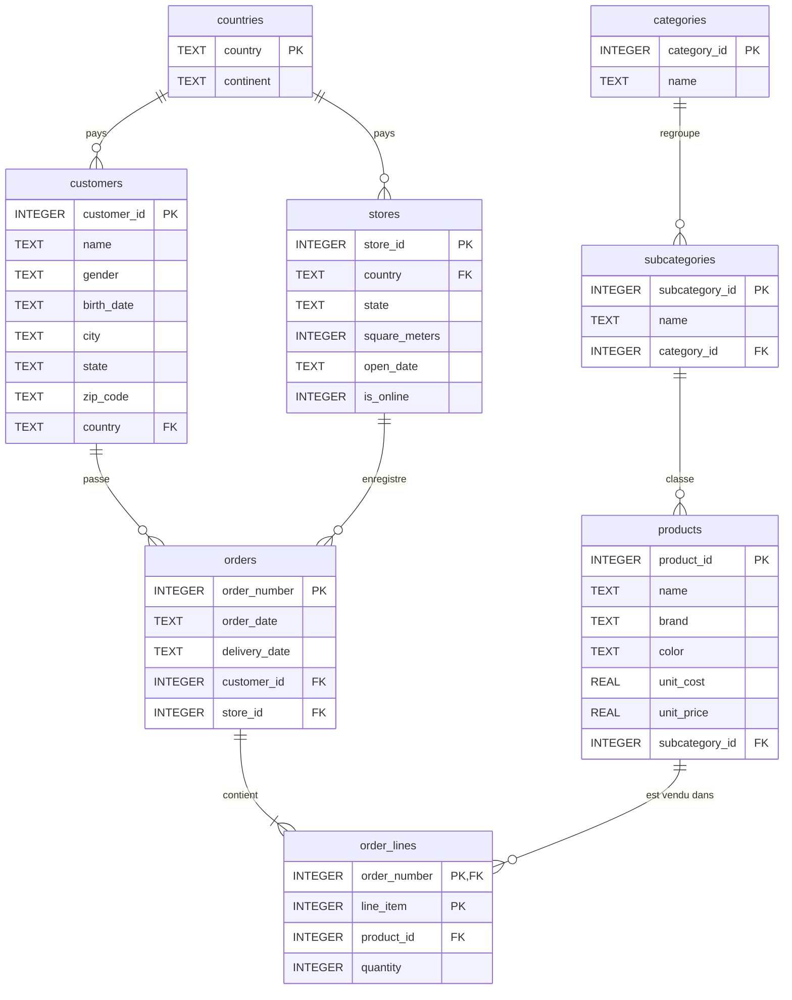

# Analyse des ventes d'un distributeur d'électronique en SQL

Conception d'une base de données relationnelle en 3e forme normale et analyse des ventes en SQL
(26 326 commandes, 11 887 clients, 8 pays, 2016-2021). Le projet est entièrement reproductible :
un script reconstruit la base SQLite à partir des CSV, et un notebook exécute les requêtes KPI.

**Auteurs :** Bakou KEITA, Florian NKOUAKE, Lukas EKLU, Maxime MIGNON

## Résultats clés

| Indicateur | Valeur |
|---|---|
| Chiffre d'affaires (janv. 2016 - fév. 2021) | **55,8 M$** |
| Taux de marge brute | 58,6 % |
| Panier moyen | 2 118 $ |
| Part des magasins physiques dans le CA | **79,5 %** (en ligne : 20,5 %) |
| Croissance 2016 → 2019 | x 2,6 |
| Évolution 2020 | **-49 %** |
| Clients n'ayant commandé qu'une fois | 39 % |

- **Forte croissance jusqu'en 2019, puis effondrement en 2020.** Les ventes chutent dès avril 2020
  et ne se redressent pas : 1,2 M$ au 4e trimestre 2020 contre 5,8 M$ un an plus tôt.
- **Saisonnalité marquée** : de 2016 à 2019, le 4e trimestre est toujours le meilleur et le 2e le plus faible.
- **Ordinateurs et électroménager** font 54 % du CA. Les taux de marge sont homogènes entre
  catégories (55 à 61 %).
- **La boutique en ligne progresse** (17 % du CA en 2016, 22 % en 2020) et livre deux fois plus vite
  (7,2 jours en 2016, 3,8 jours en 2021).
- **Les États-Unis pèsent 54 % du CA** ; Toronto est la première ville.





## Modèle de données



Par rapport au modèle initial, les dépendances transitives ont été éliminées
(catégories / sous-catégories, en-tête / lignes de commande, pays / continent) et les contraintes
d'intégrité déclarées : clés primaires et étrangères, `NOT NULL`, `CHECK`, index.

## Structure du projet

```
├── analyse_ventes.ipynb       # Notebook exécuté : requêtes, résultats, graphiques, recommandations
├── build_database.py          # Reconstruit ventes.db à partir des CSV (nettoyage + contrôles d'intégrité)
├── sql/
│   ├── 01_schema.sql          # Schéma en 3FN (tables, clés, contraintes, index)
│   ├── 02_vues.sql            # Vue analytique v_ventes (CA et marge par ligne de commande)
│   └── 03_kpis.sql            # 13 requêtes KPI (CTE, fonctions de fenêtrage)
├── data/                      # CSV normalisés (source)
├── figures/                   # Graphiques générés par le notebook
└── docs/livrables_originaux/  # Livrables du projet initial (présentation, rapport, diagramme,
                               # dump MySQL, requêtes et résultats BigQuery)
```

## Installation et exécution

```bash
pip install -r requirements.txt
```

```bash
python build_database.py
```

Le script crée `ventes.db` et vérifie l'intégrité de la base. Le notebook `analyse_ventes.ipynb`
reconstruit lui-même la base avant d'exécuter les requêtes. Les requêtes de `sql/03_kpis.sql`
peuvent aussi être exécutées dans n'importe quel client SQLite (DB Browser for SQLite, DBeaver…).

Testé avec Python 3.12 (SQLite 3.49), pandas 3.0 et matplotlib 3.11.

## Données

Ventes d'un distributeur fictif d'électronique grand public (marques Contoso, Adventure Works,
Wide World Importers…), issues du jeu de données public *Global Electronics Retailer* de
Maven Analytics. Les montants sont en dollars US, au prix catalogue. La marge est la différence
entre prix de vente et coût du produit (marge brute, hors frais de magasin et de livraison).

## Évolution par rapport au projet initial

Le projet a d'abord été réalisé sous BigQuery (voir `docs/livrables_originaux/`). Cette version
le rend reproductible et corrige plusieurs points :

- **Modèle** : le dump MySQL ne déclarait aucune clé et ne contenait qu'un échantillon des
  données ; le modèle conservait des dépendances transitives.
- **Top 10 des villes** : regroupé par nom de ville uniquement, il additionnait des villes
  homonymes de pays différents (Toronto au Canada et aux États-Unis).
- **Analyse** :
  - l'activité était présentée comme un site de vente en ligne, alors que 79,5 % du CA est
    réalisé en magasin ;
  - la catégorie « Music, Movies and Audio Books » était décrite comme peu rentable, alors
    qu'elle a le meilleur taux de marge (61 %) ;
  - la « croissance soutenue » ignorait la chute de 2020 ;
  - des quantités vendues étaient présentées comme des nombres de transactions.
- **Nouveaux indicateurs** : marge, canal de vente, panier moyen, délai de livraison, fréquence
  d'achat, croissance annuelle.
